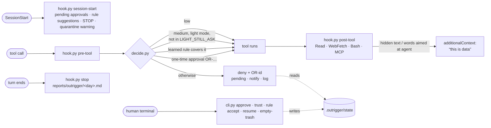

# Outrigger — architecture (0.4.0)

> One page: what runs when, where every file lives, which module owns what. Decisions behind it: [ADR index](adr/README.md).
> Coverage and gaps: [RISK_REGISTER.md](RISK_REGISTER.md).

## 1. Two layers, one rule: the guard does not trust the agent

| Layer | Who reads it | Enforced? | Where |
| :-- | :-- | :-: | :-- |
| **Rules** (what the agent should do) | the agent | no — text | `AGENTS.md` (pointer) → `.outrigger/OUTRIGGER.md`, `.outrigger/rules/*.md`, `.outrigger/templates/*.md` |
| **Guard** (what the agent can do) | the hook, before and after every tool call | **yes** — fail-closed | `.outrigger/engine/` (Python ≥ 3.11, stdlib only) |

The guard judges **what the engine sees** (paths, commands, file bytes), never the agent's stated purpose (ADR-0010).
A hijacked agent is still blocked.

## 2. What runs when (Claude Code)



| Event | Can block? | On error |
| :-- | :-: | :-- |
| `pre-tool` | **yes** | **deny** (exit 2) — fail-closed |
| `post-tool` | no (content already read) | exit 0 — never breaks the session |
| `session-start`, `stop` | no | exit 0 |

### Inside `decide()` — from a tool call to a verdict

1. **Classify the tool**: shell · write · read · fetch · schedule · MCP.
2. **Shell** → `shell.split_commands` (pipes, `&&`, wrappers like `bash -c`, heredocs) → for each simple command, follow
   `cd`, then `rules.check_segment`: secrets, guarded writes, system/registry/firewall, schedules, git, delete, network,
   install, Outrigger's own CLI, apps, **quarantine**, packs, **scripts it is about to run** (read first, up to 3 levels).
   Plus `check_raw` on the whole line (pipe-to-shell, encoded commands, self-edits) and the quarantine pipe check.
3. **Write** → zone of each path: red · protected · originals (append-only) · quarantine · green · yellow (backup first) ·
   outside (memory / agent config / allowed / blocked).
4. **Read** → red zone or a search for secrets. **Fetch** → host allow-list.
5. **Verdict** = worst finding. `low` passes; `medium` passes in light mode unless a code is in `LIGHT_STILL_ASK`;
   then a learned rule (`learn.covered`), then a one-time approval bound to the SHA-256 of the exact input.

## 3. Folders

### This repository (`outrigger-agent`, Apache-2.0)

```
outrigger-agent/
├── install.py                      ← copies template/ into a project, merges hooks, git-ignores state + quarantine
├── adapters/claude/settings.hooks.json   ← SessionStart · PreToolUse · PostToolUse · Stop
├── template/                       ← THE PRODUCT: what lands in a user's project
│   ├── AGENTS.md  CLAUDE.md  GEMINI.md   ← rules for agents (< 8 KB)
│   └── .outrigger/
│       ├── engine/                 ← the guard (≈ 3,200 lines)
│       │   ├── hook.py             ← entry point per event; fail-closed wrapper
│       │   ├── cli.py              ← human + agent commands, selftest CASES
│       │   └── outrigger/
│       │       ├── decide.py       ← tool call → Decision (§2)
│       │       ├── rules.py        ← shell rules, script reading, quarantine, git, network, delete
│       │       ├── shell.py        ← command splitter (bash + PowerShell heuristics)
│       │       ├── config.py       ← outrigger.toml + defaults, zones, packs, project root
│       │       ├── packs.py        ← scan code a pack's tool will run (MATLAB .m, .py, .js…)
│       │       ├── state.py        ← logs, approvals, trust, backups, trash, archive, STOP
│       │       ├── learn.py        ← standing rules from repeated approvals (ADR-0011)
│       │       ├── capture.py      ← trace log → draft workflow (ADR-0009)
│       │       ├── recon.py        ← quarantine clone, neutralise, content detectors (ADR-0012)
│       │       └── notify.py       ← toast / ntfy (risk + project + id only)
│       ├── outrigger.toml          ← zones, limits, allow-listed hosts, approvals mode — human-edited, guard-protected
│       ├── rules/                  ← levels · gates · sources · zones · records · models · safe-probe · deletion · recon
│       ├── templates/              ← 12 records: REQ GATE REPORT ADR HANDOFF POSTMORTEM RISK SPIKE BUG STATUS MEETING WORKFLOW
│       └── packs/{python,node}/pack.toml   ← core packs
├── tests/                          ← test_outrigger.py (Rules, Recon, LightMode, LearnedRules… + RegisterIntegrity)
└── docs/  adr/ · RISK_REGISTER.md · ROADMAP.md · specs/ · en/ · vi/ · ARCHITECTURE.md
```

### Pro (`outrigger-agent-pro`, commercial, private)

```
outrigger-agent-pro/
├── packs/matlab/       ← pack.toml (guard manifest) · workflows/MAT-01…07 · standards/SOURCES.md
├── builder/INTERVIEW.md   ← 3-round interview → the user's own workflow in .outrigger/local/
├── demo/matlab-spring/    ← demo project with a trap file (extras/cleanup_old_results.m)
└── docs/demo-matlab.vi.md
```

A pack is **data**: the engine knows nothing about MATLAB. `install.py --pack <folder>` copies it to
`.outrigger/packs/<id>/`; the guard reads `pack.toml` (commands, headless flags, extensions to scan, dangerous patterns).

### A guarded project after install

```
your-project/
├── AGENTS.md CLAUDE.md GEMINI.md     ← yours, plus one marked pointer block
├── .claude/settings.json             ← your hooks + Outrigger's (protected)
├── sandbox/                          ← green: experiments
│   └── quarantine/<repo>@<commit>/   ← someone else's code: read only (git-ignored)
├── reports/
│   ├── outrigger/<day>.md            ← guard log per turn (Stop hook)
│   ├── recon/<repo>@<commit>.md/.json
│   └── <YYYY-MM-DD>/REPORT-*.md      ← the agent's turn reports
├── docs/decisions/ADR-*.md           ← never deleted
└── .outrigger/
    ├── local/                        ← YOURS: workflows, drafts, notify.toml — updates never touch it
    └── state/                        ← git-ignored, guard-protected
        ├── logs/ audit-YYYY-MM.jsonl · trace-YYYY-MM.jsonl · apps.jsonl
        ├── approvals/ pending/ · approved/
        ├── trusted.json · rules.json
        ├── backups/<date>/ · trash/<id>/manifest.json · last_stop
```

## 4. Extension points

| To add | Touch | Must also |
| :-- | :-- | :-- |
| A guard rule | `rules.py` or `decide.py` | test in `tests/test_outrigger.py`, selftest case if user-visible, RISK_REGISTER row |
| Support for a tool (MATLAB, R…) | a pack: `pack.toml` (+ workflows) | `PACK_CASES` in `cli.py` for selftest |
| A user's own way of working | `.outrigger/local/workflows/` (builder or `capture`) | nothing in the engine |
| Another agent platform | `hook.py` adapter (Codex, Gemini, Cursor: planned) | live check on that platform |
| A behaviour change | — | ADR first |
